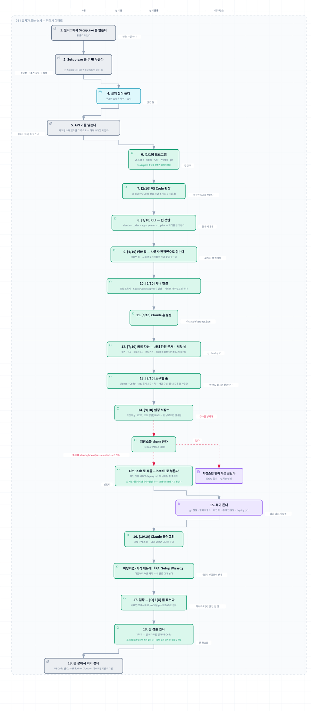

# PAISetup

Posco Futurem AI setup Wizard — 윈도우 PC 에 Claude Code 개발 환경을 한 번에 세우는 사내 설치본

포스코 사람용이다. 사내 PC · 사외 VDI · 사내 VDI · 집, 네 자리 어디서든 같은 `Setup.exe` 하나를 누르면 된다. 사내에서는 회사
게이트웨이에 붙이고 사외에서는 개인 구독으로 세우는데, 어느 쪽인지는 설치가 회사 게이트웨이에 닿는지를 재서 스스로 가른다.

## 목차

- [보안](#보안)
- [왜 있나](#왜-있나)
- [설치](#설치)
- [쓰기](#쓰기)
- [무엇이 깔리나](#무엇이-깔리나)
- [안 될 때](#안-될-때)
- [무를 때](#무를-때)
- [새 판이 나오면](#새-판이-나오면)
- [문의](#문의)
- [기여](#기여)
- [라이선스](#라이선스)

## 보안

키는 설치 묶음에 안 담겨 오고, 사람마다 제 키를 설치할 때 넣는다.

- 설치 창이 키를 물어 화면에 안 찍히게 받고, 사용자 환경변수로 심는다. 받은 그대로의 묶음에는 키 칸이 비어 있다
- 키는 사람마다 제 것이다 — 남의 것을 받아 쓰지 않는다
- 같은 PC 에서 다시 누르면 이미 심긴 키를 설치 창이 채워 둔다
- 여러 대를 세우느라 펴진 묶음의 `install.env`(`%LOCALAPPDATA%\Claude Code Setup\<판>\`)에 제 키를 적었으면 남에게 안 넘긴다
- ⚠ 그 파일의 `#이름 = 값` 줄은 주석이 아니라 설치가 읽는 지시다 — `#` 를 지우면 그 줄이 죽으니, 파일 머리말을 먼저 읽고 고친다

## 왜 있나

맨바닥 PC 에서 Claude Code 를 쓰려면 프로그램 몇 개를 깔고, VS Code 확장을 붙이고, 게이트웨이 주소와 키를 사용자 환경변수에 심어야
한다. 순서를 하나만 어겨도 아무 말 없이 어긋난다 — 확장은 깔렸는데 실행할 CLI 가 없거나, 키는 심었는데 창을 안 닫아 새 값이 안
먹거나, 파이썬은 깔렸는데 윈도우가 미리 깔아 둔 가짜 실행 파일이 대신 잡히거나. 이런 자리를 다 겪고 나서 순서와 확인을 한 파일에
담았다. 설치 창과 바탕화면 아이콘에는 「PAI Setup Wizard」라는 이름으로 뜬다.

## 설치

설치는 `Setup.exe` 하나를 받아 두 번 누르고 기다리는 일이다.



그림의 가로 띠 넷이 「누가 하나」다 — 손을 대는 것은 `사람` 띠의 네 칸뿐이고, `내 저장소` 띠는 [내 저장소 받기](#내-저장소-받기)
칸을 채운 사람만 돈다. 칸 안의 ⚠ 작은 글씨가 실제로 사람들이 걸린 자리이고, 잘린 글자는 마우스를 올리면 전문이 뜬다.

1. 릴리스에서 `Setup.exe` 를 받는다 — 받을 것은 그 파일 하나다
2. 두 번 누르면 설치 창이 뜬다 — 처음 한 번은 [윈도우가 막는다](#윈도우가-한-번-막는다)
3. API 키를 넣는다 — 주소는 채워져 있고, 사외면 이 칸 대신 「사외입니다」 한 줄만 뜬다
4. [설치 시작]을 누르고 막대가 차기를 기다린다 — 뒤에 뜨는 콘솔 창이 설치 기록을 그대로 흘려 준다
5. 사외이고 Claude 로그인이 안 돼 있으면 브라우저가 뜨고 최대 180초 기다린다 — 로그인하면 이어 간다
6. 저장소 주소를 넣었으면 마지막 칸 직전에 GitHub CLI 로그인 코드 팝업이 뜬다 — [브라우저 열기]를 누르고 그 코드를 넣는다
7. 검증이 끝나면 깐 앱을 띄운다 — 이미 떠 있는 것이 있으면 껐다 새로 열지 먼저 묻는다

걸음마다 무슨 일이 나는지는 [INSTALLED.md 「설치가 도는 동안」](INSTALLED.md#설치가-도는-동안)이 든다.

### 윈도우가 한 번 막는다

인터넷에서 받은 파일이라 처음 누를 때 파란 「Windows의 PC 보호」 창이 뜨고, 거기서 멈추지 않으면 된다.

「추가 정보」를 누르면 아래에 「실행」 단추가 나오고, 그것을 눌러야 시작된다 — 창을 그냥 닫으면 아무 일도 안 일어난 것처럼 보인다.
서명을 사지 않은 파일이라 뜨는 창이다. 이 창을 거치지 않고 받는 길(PowerShell 에 붙여 넣는 몇 줄 — 지문을 맞춰 보고 같을 때만
띄운다)과 Edge 가 내려받기부터 막을 때 푸는 법은 릴리스 본문에 있다.

### 설치 창의 칸

설치 창의 칸은 그대로 두면 된다.

| 칸 | 기본 | 무엇 |
|---|---|---|
| 설치할 것 — Claude · Codex · 구글 Antigravity · GitHub Copilot | Copilot 만 꺼짐 | 켠 도구의 CLI · VS Code 확장 · 데스크탑 앱이 깔린다 |
| VS Code 와 켠 것의 확장도 깝니다 | 사내 켜짐(못 끈다) · 사외 꺼짐 | 끄면 VS Code 도 확장도 안 깔린다 |
| 제작자의 규범 · 룰 · 스킬도 깝니다 | 다 꺼짐 | 만든 사람의 작업 규율을 도구마다 골라 받는다 |
| 이미 깔린 것도 최신으로 올립니다 | 켜짐 | 옛 판이 깔려 있으면 올린다. 꺼도 VC++ 런타임은 14.40 아래면 올린다 |
| 로그온할 때와 밤마다 깔린 것을 최신으로 올리고 환경을 맞춥니다 | 켜짐 · 끄고 설치한 PC 는 꺼짐 | 하루 한 번 혼자 돌며 최신으로 맞춘다 |
| 내 저장소 받기 | 비어 있음 | 제 설정 저장소를 받아 둔다 |

개발 도구(Git · Python · GitHub CLI)는 칸 없이 늘 깔리고, 빼려면 아래 [깃발](#여러-대를-같은-값으로) `-NoDevTools` 를 쓴다. 칸마다
고르면 무엇이 달라지나는 [INSTALLED.md 「설치 창의 칸」](INSTALLED.md#설치-창의-칸)이 든다.

## 쓰기

설치가 끝나면 설치 창 기록 칸의 끝 줄이 결과를 판정한다.

```text
=== 검증 ===
  [O] VS Code
  [O] 클로드 확장
  [O] Claude Code CLI
  [O] ANTHROPIC_AUTH_TOKEN

=== 끝 === VS Code 를 열었습니다 — Ctrl+Shift+P → Claude 로 확장을 엽니다
```

- 위는 사내에서 Claude 만 켠 판을 줄인 것이고, 고른 도구와 자리에 따라 줄이 더 붙는다
- 하나라도 `[X]` 나 `[?]` 가 서면 안 선 것이다 — 창 아래 줄도 빨갛게 바뀐다. 노란 `[?]` 는 「없다」가 아니라 「못 쟀다」다. 줄마다
  다음 걸음은 [TROUBLESHOOTING.md](TROUBLESHOOTING.md#검증-칸에-x-가-서면)가 든다
- 마지막 `=== 끝 ===` 줄이 다음에 할 일을 댄다. 띄운 것이 VS Code 면 `Ctrl+Shift+P` → `Claude` 로 확장을 연다
- 바탕화면과 시작 메뉴에 「PAI Setup Wizard」 꽃 아이콘이 생긴다 — 다음부터는 그것을 누르고, 누르면 새 판도 같이 봐 준다
  ([새 판이 나오면](#새-판이-나오면))
- 자동 실행 칸을 켜 두면 로그인하고 1분 뒤와 매일 새벽 3시 무렵에 설치가 혼자 돌아 깔린 것을 하루 한 번 최신으로 올린다 —
  [INSTALLED.md](INSTALLED.md#로그온할-때와-밤마다-혼자-도는-것)

### 내 저장소 받기

「내 저장소 받기」 칸은 빈 칸이 기본이고 맞는 답이다 — 이 칸과 상관없이 다 깔리고, 채워도 그대로다.

제 설정 저장소가 있는 사람만 그 주소를 넣는다. 설치는 `~/repos/<저장소 이름>` 으로 받고, 칸 아래 「받는자리」를 누르면 그 폴더가
열린다 — 아직 아무것도 안 받았으면 그 폴더가 없는 것이 정상이다. 여러 개는 빈칸으로 가른다.

```text
https://github.com/나/설정.git  https://github.com/나/메모.git
```

설정 저장소가 무엇이고 어떻게 만드나는 칸 옆 「설정저장소 만드는 법」 링크가 여는 안내 한 장이 든다 — 설치 뒤에도
`~/.claude/seeds/config-repo/config-repo-howto.html` 을 더블클릭하면 같은 장이 열린다. 받은 저장소에 무엇이 넘어가나는
[INSTALLED.md 「내 저장소 받기를 채우면」](INSTALLED.md#내-저장소-받기를-채우면)이 든다.

### 여러 대를 같은 값으로

칸은 창에서 고르지만, 여러 대를 같은 값으로 세울 때는 `Setup.exe` 에 깃발을 붙여 칸을 미리 채워 둔다 — 창은 그대로 뜬다.

```powershell
.\Setup.exe -NoDevTools                # 개발 도구(Git · Python · GitHub CLI)를 빼고 깐다 — 창에는 이 칸이 없다
.\Setup.exe -PersonalFor claude,codex  # 제작자 칸에서 그 도구를 켠 채로 연다(claude · codex · agy)
.\Setup.exe -WithPersonalConfig        # 제작자 칸을 Claude 만 켠 채로 연다
.\Setup.exe -NoUpgrade                 # 갱신 칸을 끈 채로 연다
```

창까지 안 띄우려면 펴진 묶음의 `install.ps1` 을 직접 부른다 — [INSTALLED.md 「창 없이 돌리기」](INSTALLED.md#창-없이-돌리기).

## 무엇이 깔리나

설치 창에서 켠 도구와 자리(사내 · 사외)에 맞춰 아래가 깔린다.

| 무엇 | 언제 |
|---|---|
| [고른 도구](INSTALLED.md#고른-도구)의 CLI · VS Code 확장 · 데스크탑 앱 | 설치 창에서 켠 도구만 |
| [Node.js](INSTALLED.md#nodejs-와-npm-전역-자리) | 늘(`-NoDevTools` 를 줘도 깐다) |
| [개발 도구](INSTALLED.md#개발-도구) Git · Python · GitHub CLI | 늘(`-NoDevTools` 로 빼도 필요한 Python 은 깐다) |
| [회사 게이트웨이 연결](INSTALLED.md#회사-게이트웨이-연결) — 주소 · 모델 · 키 · 로컬 프록시 | 사내에서만 |
| [Claude Code 홈 설정](INSTALLED.md#claude-code-홈-설정)과 Claude 훅 여섯 | 홈 설정은 늘 맞추고, 훅은 Claude 를 고르면 |
| [Codex 훅](INSTALLED.md#codex-훅) 다섯 | Codex 를 고르면 |
| [브라우저 MCP](INSTALLED.md#브라우저-mcp) | Claude · Codex · Antigravity 가운데 하나라도 고르면 |
| [칸 없이 깔리는 스킬](INSTALLED.md#칸-없이-깔리는-스킬) — 회사 DRM 문서 읽기 · 사내 앱 · 일 맡기기 | 고른 도구마다, 제작자 칸과 상관없이 |
| [제작자의 규범 · 룰 · 스킬](INSTALLED.md#제작자의-규범--룰--스킬) | 제작자 칸에서 켠 도구만 |
| [묻지 않고 돌기](INSTALLED.md#묻지-않고-돌기) 설정 | 고른 agy · Copilot 은 늘, Codex 는 사외에서만 |
| [사내 환경 문서와 견본 폴더](INSTALLED.md#사내-환경-문서와-견본-폴더) | 늘(스위치가 없다) |
| [워드의 PDF 변환 안내 끄기](INSTALLED.md#워드의-pdf-변환-안내-끄기) | 워드가 깔린 PC 면 |

무엇을 할 수 있게 되나는 설치 창의 「제공기능」 링크(`features.html`)가 한 장으로 보여 준다 — 판의 앞 두 자리가 새로 오른 판을 처음
깐 PC 에서는 설치가 끝날 때 그 페이지를 한 번 연다. 어디에 어떤 조건으로 깔리나는 [INSTALLED.md](INSTALLED.md)가 든다.

## 안 될 때

화면에 뜬 말을 그대로 들고 [TROUBLESHOOTING.md](TROUBLESHOOTING.md)에서 다음 걸음을 찾는다.

- 설치 창이 뜨기도 전에 작은 창 하나만 떴다 → [Setup.exe 가 낸 창](TROUBLESHOOTING.md#setupexe-가-낸-창)
- 아무 창도 없이 받은 파일이 사라졌다 → 백신이다. 백신이 낸 문구를 그대로 복사해 설치본을 보낸 사람에게 보낸다
- 검증 칸에 `[X]` 나 `[?]` 가 섰다 → 첫 번째 것부터 [검증 줄마다 다음 걸음](TROUBLESHOOTING.md#검증-줄마다-다음-걸음)
- 창을 닫았다 → 설치 기록이 `%LOCALAPPDATA%\Claude Code Setup\logs\` 에 남고, 설치 창의 「설치기록」 링크가 가장 최근 것을 집어 준다

## 무를 때

되돌리는 스위치는 아직 없어, PC 를 반납하거나 개인 구독으로 돌아갈 때는 손으로 지운다. 맨 먼저 걷을 것은 자동 실행 작업 둘이다 —
남아 있으면 로그온 · 밤마다 설치가 다시 돌아 지운 것을 도로 깐다.

⚠ 그다음 급한 것은 게이트웨이 주소다. `ANTHROPIC_BASE_URL` 이 사내 로컬 프록시를 가리킨 채로 남으면 사외로 나간 노트북의 Claude 가
돌지도 않는 프록시로 요청을 보낸다 — 사용자 환경변수와 `~/.claude/settings.json` 두 곳에서 다 지운다. 나머지 지울 것과 차례는
[UNINSTALL.md](UNINSTALL.md)가 든다.

## 새 판이 나오면

모델 이름이 바뀌거나 게이트웨이가 옮겨지면 깔린 것이 낡으니, 새 판을 받아 다시 누른다.

- 로그온 자동 실행 칸을 켰으면 로그인할 때 새 판을 받아 저절로 따라간다
- 안 켰으면 바탕화면의 「PAI Setup Wizard」 를 누른다. 새 판이 있으면 받을지 묻고, 받은 파일을 릴리스에 같이 오른 SHA-256 지문과
  대조한 뒤 띄운다 — 지문을 못 쟀거나 다르면 띄우지 않고 까닭을 댄다. 설치 창이 직접 받는 것이라 파란 경고 창은 안 뜬다
- 새 `Setup.exe` 를 릴리스에서 받아 눌러도 같다
- 여러 번 눌러도 안전하다. 바뀐 것만 `올렸다 1.2.3 -> 1.2.9` 처럼 찍고, 깔린 판을 못 읽은 것은 `(판을 못 읽었다)` 로 찍은 채 그
  위에 새로 깔지 않는다
- 지금 판 번호는 설치 창 제목줄에 뜨고, 판마다 바뀐 것은 릴리스 쪽에 적혀 있다

## 문의

이 설치본을 낸 사람에게 묻는다 — 메일 주소는 설치 창 단추 줄 왼쪽, 「설치기록」 곁의 「문의」 링크에 뜨고 누르면 메일 창이 열린다.

설치 화면을 통째로 복사해서 보내면 빠르다 — 어느 칸에서 멈췄는지가 거기 다 찍힌다. 창이 아직 떠 있으면 「설치기록」이 보낼 파일을
집어 주고, 창을 닫았으면 [설치 기록 파일](TROUBLESHOOTING.md#설치-기록-파일)을 보낸다.

## 기여

막히거나 바라는 것은 이 저장소에 이슈로 남긴다 — 공개 저장소라 회사 문서 · 키 · 사내 주소는 적지 않는다.

## 라이선스

MIT 라이선스로 낸다 — 전문은 저장소 뿌리의 LICENSE 파일이다.

포스코 사람용이다. 회사 키 · 프록시 · 회사 설정은 게이트웨이가 닿는 사내에서만 뜻이 있어 사내에서만 세우고, 사외에서는
구독이나 개인 계정 로그인으로 쓴다. 프로그램(고른 도구의 CLI · 확장 · 데스크탑 앱)은 어디서나 깔린다.
