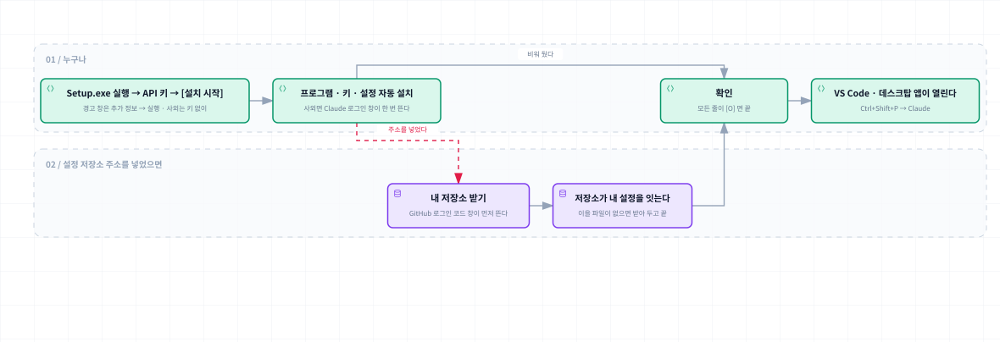

# PAISetup

Posco Futurem AI setup Wizard — `Setup.exe` 하나로 윈도우 PC 에 Claude Code 와 AI 코딩 도구를 설치합니다.

1분 소개 영상입니다. 말소리 없이 한국어 자막과 잔잔한 배경음악이 나옵니다.

<!-- markdownlint-disable-next-line MD033 -- GitHub 이 README 안에서 영상을 틀어 주는 꼴은 video 태그뿐이다 -->
<video src="https://github.com/user-attachments/assets/7e609549-ce25-4ce6-88e6-2a2ad81afde0" controls width="100%"></video>

## 목차

- [보안](#보안)
- [왜 만들었나](#왜-만들었나)
- [설치](#설치)
- [처음 써 보기](#처음-써-보기)
- [업데이트](#업데이트)
- [안 될 때](#안-될-때)
- [지우기](#지우기)
- [여러 대에 같은 값으로 설치하기](#여러-대에-같은-값으로-설치하기)
- [문의](#문의)
- [기여](#기여)
- [라이선스](#라이선스)

## 보안

API 키는 사람마다 따로 받는 본인 것입니다.

- 남의 키를 빌려 쓰거나 내 키를 남에게 주지 않습니다
- 키는 설치 창의 「API 키」 입력란에만 넣습니다. 입력란은 글자를 가려서 보여 주고, 설치는 키를 이 PC 의 사용자 환경변수에 저장합니다
- 내려받은 설치 파일에는 키가 들어 있지 않습니다. 설치 기록 파일에도 키는 남지 않습니다
- 이 저장소는 공개 저장소입니다. 이슈나 질문에 키 · 회사 문서 · 사내 주소를 적지 않습니다

## 왜 만들었나

Claude Code 를 손으로 설치하려면 프로그램 몇 개를 깔고, VS Code 확장을 붙이고, 회사 게이트웨이 연결 값과 키를 환경변수에 넣어야
합니다. 순서가 하나만 어긋나도 오류 메시지 없이 동작하지 않습니다. 예를 들면 이런 일이 생깁니다.

- 확장은 설치됐는데 확장이 부르는 CLI 가 없습니다
- 키를 넣었는데 열려 있던 창을 다시 열지 않아 새 값을 읽지 못합니다
- Python 을 설치했는데 윈도우에 미리 들어 있는 가짜 실행 파일이 대신 실행됩니다

이 설치기는 그런 순서와 확인을 대신 해 줍니다. 사내망인지 사외(집 · 외부망)인지도 스스로 판단해서, 사내에서는 회사 게이트웨이
(P-GPT)로, 사외에서는 개인 구독으로 연결합니다. 설치 창과 바탕화면 아이콘에는 「PAI Setup Wizard」라는 이름으로 나옵니다.

## 설치

### 준비할 것

- 윈도우 10(1803 이후) 또는 윈도우 11 PC
- **회사 PC 라면 API 키.** P-GPT 앱 안의 API 신청 절차로 신청해서 받습니다. 사외(집 · 외부망)에서는 키가 필요 없고, 설치
  중에 Claude 구독 계정으로 로그인합니다

### 설치 순서

1. 이 저장소 페이지 오른쪽의 **Releases** 에서 가장 최근 버전(Latest)을 열고, **Assets** 아래의 `Setup.exe` 를 내려받습니다.
2. 내려받은 `Setup.exe` 를 더블클릭합니다. 파란 「Windows의 PC 보호」 창이 뜨면 [아래](#파란-경고-창이-뜨면)를 봅니다.
3. 설치 창이 뜨면 「연결」의 **API 키** 입력란에 받은 키를 붙여 넣습니다. 다시 설치할 때는 이미 넣은 키가 채워져 있고, 사외에서는 이 입력란이 잠겨 있으니 그냥 넘어갑니다.
4. **[설치 시작]** 을 누릅니다. Enter 키를 눌러도 됩니다. 다른 항목은 그대로 두면 됩니다.
5. 「설치하는 중」 카드의 막대가 다 찰 때까지 기다립니다. 사외에서 Claude 로그인이 안 되어 있으면 중간에 브라우저가 열리니,
   3분 안에 로그인합니다.
6. 카드 제목이 **끝났습니다** 로 바뀌고 초록 글씨가 뜨면 설치가 끝난 것입니다. 이어서 VS Code 나 데스크탑 앱이 저절로
   열립니다. 다음은 [처음 써 보기](#처음-써-보기)입니다.



위 그림의 아래 줄은 「내 저장소 받기」에 주소를 넣었을 때만 지나갑니다([설정 저장소가 있다면](#설정-저장소가-있다면)).
단계마다 무슨 일이 일어나는지는 [전체 설치 흐름 그림](install-flow.svg)과
[INSTALLED.md 「설치가 도는 동안」](INSTALLED.md#설치가-도는-동안)에 있습니다.

### 파란 경고 창이 뜨면

「추가 정보」를 누르면 아래에 **[실행]** 단추가 나옵니다. 그것을 눌러야 설치 창이 뜹니다. 창을 그냥 닫으면 아무 일도 일어나지
않습니다.

인터넷에서 받은 파일인데 유료 코드 서명이 없어서 뜨는 창입니다. 이 창 없이 받는 방법(PowerShell 에 몇 줄을 붙여 넣으면 지문을
맞춰 본 뒤 실행합니다)과 Edge 가 내려받기를 막을 때 푸는 방법은 릴리스 설명에 있습니다.

### 결과가 빨간색이면

카드 제목이 **끝내지 못했습니다** 로 바뀌면 덜 설치된 것이 있다는 뜻입니다.

1. 카드의 「기록 펼치기」를 눌러 `=== 검증 ===` 아래 줄들을 봅니다.
2. `[X]` 나 `[?]` 가 붙은 첫 줄의 이름을 [검증 줄마다 다음 걸음](TROUBLESHOOTING.md#검증-줄마다-다음-걸음)에서 찾습니다.

`[?]` 는 「없다」가 아니라 「확인하지 못했다」는 뜻입니다. 다 잘 끝났을 때의 기록 끝부분은 이런 모양입니다(사내에서 Claude 만
켠 경우를 줄인 것이고, 고른 도구에 따라 줄이 더 붙습니다).

```text
=== 검증 ===
  [O] VS Code
  [O] 클로드 확장
  [O] Claude Code CLI
  [O] ANTHROPIC_AUTH_TOKEN

=== 끝 === VS Code 를 열었습니다 — Ctrl+Shift+P → Claude 로 확장을 엽니다
```

### 설치 창에서 고를 수 있는 것

처음 설치라면 API 키만 넣고 나머지는 그대로 두면 됩니다. 창의 짜임은 사내와 사외가 같습니다. 지금 어디인지는 창 오른쪽 위의
배지가 알려 주고, 그곳에서 쓰지 않는 항목은 사라지지 않고 잠긴 채 짧은 이유가 붙습니다.

| 항목 | 처음 상태 | 하는 일 |
|---|---|---|
| 설치할 도구(Claude · Codex · 구글 Antigravity · GitHub Copilot) | Copilot 만 꺼져 있습니다. 사내에서는 Copilot 이 「사내 지원 전」으로 잠깁니다 | 켠 도구의 CLI 와 데스크탑 앱을 설치합니다. 사외에서만 설치되는 앱은 그 아래 안내 줄이 알려 줍니다 |
| VS Code 와 켠 것의 확장도 깝니다 | 사내는 켜진 채 잠겨 있고(필수), 사외는 꺼져 있습니다 | VS Code 와 켠 도구의 VS Code 확장을 설치합니다 |
| 내 저장소 받기 | 비어 있습니다 | 적은 저장소를 이 PC 에 내려받습니다. [설정 저장소가 있다면](#설정-저장소가-있다면)을 봅니다 |
| 자세히 설정 | 접혀 있고, 접힌 머리에 지금 값이 한 줄로 보입니다 | 자동 업데이트 · 이미 깔린 것도 올리기 · 규범 · 룰 · 스킬을 받을 모델(처음에는 Claude 만)을 고릅니다 |

- Git · Python · GitHub CLI · Node.js 는 고르는 항목 없이 늘 설치됩니다. 개발 도구를 빼야 하면
  [`-NoDevTools` 옵션](#여러-대에-같은-값으로-설치하기)을 씁니다
- 「규범 · 룰 · 스킬」은 AI 에게 주는 작업 규칙 묶음입니다. 저장소 주소를 넣지 않으면 이 설치기를 만든 사람의 것이, 넣으면 내 저장소의
  것이 설치됩니다. 바로 아래 한 줄이 지금 어느 쪽인지 알려 줍니다
- 창 아래쪽 단추 줄은 늘 보입니다. 오른쪽에 **[설치 시작]** · **[닫기]** 가 있고 Enter · Esc 키로도 누를 수 있습니다. 왼쪽 끝에는 「설치기록」이 있습니다
- 항목마다 고르면 무엇이 달라지는지는 [INSTALLED.md 「설치 창의 칸」](INSTALLED.md#설치-창의-칸)에 있습니다

### 설정 저장소가 있다면

「내 저장소 받기」에 git 저장소 주소를 넣으면 설치가 그 저장소를 `내 폴더\repos\<저장소 이름>` 으로 내려받습니다. 코드
저장소도, 설정 저장소도 됩니다. 넣지 않아도 나머지 설치는 똑같이 끝납니다.

- 저장소 페이지 주소를 붙여 넣습니다. 여러 개는 빈칸으로 구분합니다
- GitHub CLI 로그인이 안 되어 있으면 설치 초반에 로그인 코드 창이 뜹니다. [브라우저 열기]를 누르고 그 코드를 넣습니다
- **설정 저장소**는 내 Claude Code 설정을 담아 두고 어느 PC 에서나 같은 설정을 쓰게 해 주는 저장소입니다. 받은 저장소에 이어 받을
  설정이 있으면 설치가 그것까지 연결합니다. 만드는 법은 입력란 아래 「설정저장소 만드는 법」 링크가 여는 안내에 있고, 설치한 뒤에는
  `~/.claude/seeds/config-repo/config-repo-howto.html` 을 더블클릭해도 같은 안내가 열립니다
- 무엇이 어떻게 이어지는지는 [INSTALLED.md 「내 저장소 받기를 채우면」](INSTALLED.md#내-저장소-받기를-채우면)에 있습니다

## 처음 써 보기

설치가 끝나면 사내에서는 대개 VS Code 가 열리고, 사외에서는 데스크탑 앱과 VS Code 가 함께 열립니다.

**VS Code 에서**

1. `Ctrl+Shift+P` 를 누르고 `Claude` 를 입력해 Claude Code 를 엽니다.
2. VS Code 가 이 폴더를 신뢰하느냐고 물으면 **Trust(신뢰)** 를 한 번 누릅니다. 신뢰하기 전에는 확장이 꺼져 있습니다.
3. 입력란에 하고 싶은 일을 한국어로 적습니다. 처음에는 이렇게 물어보면 됩니다.

```text
이 폴더에 무엇이 있는지 설명해 줘
```

**데스크탑 앱에서**(사외)는 열린 앱 창마다 각자 로그인합니다.

무엇을 할 수 있게 됐는지는 「제공기능」 페이지에 한 장으로 정리되어 있습니다. 처음 설치한 PC 에서는 설치가 끝날 때 브라우저로
한 번 열리고, 다시 보려면 설치 창 「알아보기」 줄의 「제공기능」을 누릅니다.

## 업데이트

- 「자세히 설정」의 자동 업데이트가 켜져 있으면(처음 상태) 로그인하고 1분 뒤와 매일 새벽 3시 무렵에 설치가 저절로 돌아, 하루
  한 번 최신으로 맞춥니다. 새 버전의 설치 파일도 이때 받아 옵니다. 자세한 내용은
  [INSTALLED.md](INSTALLED.md#로그온할-때와-밤마다-혼자-도는-것)에 있습니다
- 직접 하려면 바탕화면이나 시작 메뉴의 「PAI Setup Wizard」 꽃 아이콘을 누릅니다. 새 버전이 있으면 받을지 묻고, 릴리스에 함께
  올라온 SHA-256 지문과 맞춰 본 뒤 실행합니다. 지문을 확인하지 못했거나 다르면 실행하지 않고 이유를 알려 줍니다
- 몇 번을 다시 실행해도 안전합니다. 바뀐 것만 기록에 `올렸다 1.2.3 -> 1.2.9` 처럼 남깁니다
- 지금 버전은 설치 창 제목 옆에 나옵니다. 버전마다 바뀐 것은 「알아보기」 줄의 「바뀐 것」이 여는 릴리스 목록에서 봅니다

## 안 될 때

화면에 뜬 문장을 그대로 들고 [TROUBLESHOOTING.md](TROUBLESHOOTING.md)에서 다음에 할 일을 찾습니다.

- 설치 창이 뜨기 전에 작은 창 하나만 떴습니다 → [Setup.exe 가 낸 창](TROUBLESHOOTING.md#setupexe-가-낸-창)
- 아무 창도 없이 내려받은 파일이 사라졌습니다 → 백신이 지운 것입니다. [받은 파일이 사라졌을 때](TROUBLESHOOTING.md#받은-파일이-사라졌을-때)를 봅니다
- 결과가 빨간색입니다 → [결과가 빨간색이면](#결과가-빨간색이면)
- 설치 창을 닫았습니다 → 설치 기록은 `%LOCALAPPDATA%\Claude Code Setup\logs\` 에 남습니다. 설치 창 왼쪽 아래 「설치기록」을
  누르면 가장 최근 기록 파일을 골라 둔 채 그 폴더가 열립니다

## 지우기

아직 되돌리는 단추가 없어서 손으로 지웁니다. PC 를 반납하거나 개인 구독으로 돌아갈 때 이 둘을 먼저 합니다.

1. **자동 실행 작업 둘을 지웁니다.** 남아 있으면 로그인할 때와 밤마다 설치가 다시 돌아 지운 것을 도로 설치합니다.
2. **회사 게이트웨이 설정(`ANTHROPIC_BASE_URL`)을 지웁니다.** 사용자 환경변수와 `~/.claude/settings.json` 두 곳에 있습니다.
   남아 있으면 회사 밖으로 가져간 노트북의 Claude 가 연결되지 않는 곳으로 요청을 보냅니다.

나머지 지울 것과 순서는 [UNINSTALL.md](UNINSTALL.md)에 있습니다.

## 여러 대에 같은 값으로 설치하기

여러 PC 를 같은 설정으로 설치하는 관리자용입니다. `Setup.exe` 에 옵션을 붙이면 설치 창이 그 값을 미리 고른 채로 뜹니다.

```powershell
.\Setup.exe -NoDevTools                # 개발 도구(Git · Python · GitHub CLI)를 빼고 설치합니다
.\Setup.exe -DevTools                  # 뺀 개발 도구를 다시 설치합니다
.\Setup.exe -PersonalFor claude,codex  # 규범 · 룰 · 스킬을 받을 모델을 골라 둡니다(claude · codex · agy)
.\Setup.exe -WithPersonalConfig        # 규범 · 룰 · 스킬을 받을 모델을 Claude 로 골라 둡니다
.\Setup.exe -NoUpgrade                 # 이미 깔린 것은 최신으로 올리지 않습니다
```

- `-NoDevTools` 로 뺀 개발 도구는 다음 설치에서도 빠집니다. 다시 넣을 때 `-DevTools` 를 한 번 붙입니다
- 설치 창 없이 돌리려면 풀어 놓은 설치 폴더의 `install.ps1` 을 직접 실행합니다 →
  [INSTALLED.md 「창 없이 돌리기」](INSTALLED.md#창-없이-돌리기)
- 풀어 놓은 설치 폴더(`%LOCALAPPDATA%\Claude Code Setup\<버전>\`)의 `install.env` 에 키를 적어 썼다면 그 파일을 남에게 넘기지
  않습니다. 그 파일의 `#이름 = 값` 줄은 주석이 아니라 설치가 읽는 설정이라, `#` 를 지우면 그 줄이 무시됩니다. 고치기 전에 파일
  머리말을 먼저 읽습니다

## 문의

이 설치 파일을 보내 준 사람에게 묻습니다. 메일 주소는 설치 폴더의 `install.env` 에 `#contact` 줄로 적혀 있습니다.

설치 창 화면을 통째로 찍어 보내면 가장 빠릅니다. 어느 단계에서 멈췄는지가 화면에 다 나옵니다. 창을 이미 닫았다면 「설치기록」으로
찾은 [설치 기록 파일](TROUBLESHOOTING.md#설치-기록-파일)을 보냅니다.

## 기여

막히는 점이나 바라는 점은 이 저장소에 이슈로 남깁니다. 공개 저장소라 회사 문서 · 키 · 사내 주소는 적지 않습니다.

## 라이선스

MIT 라이선스입니다. 전문은 저장소 맨 위의 LICENSE 파일에 있습니다.
